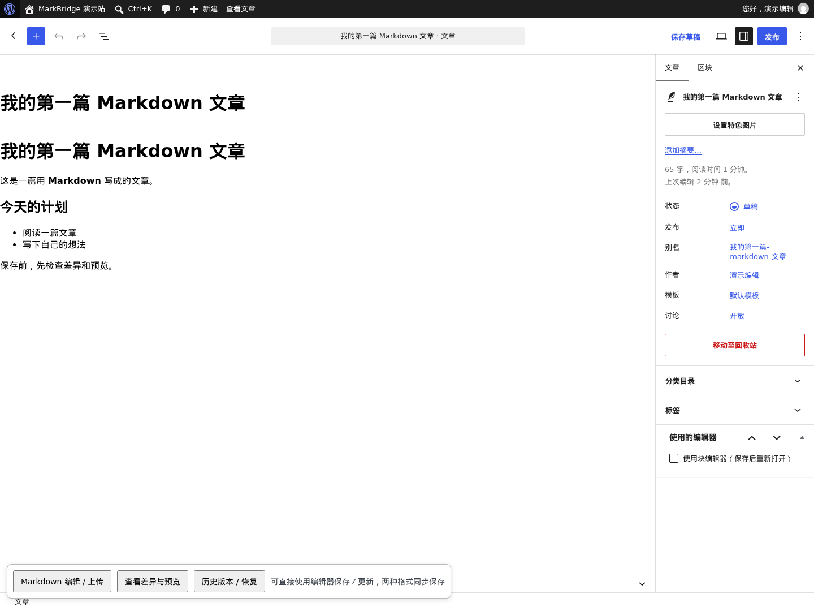
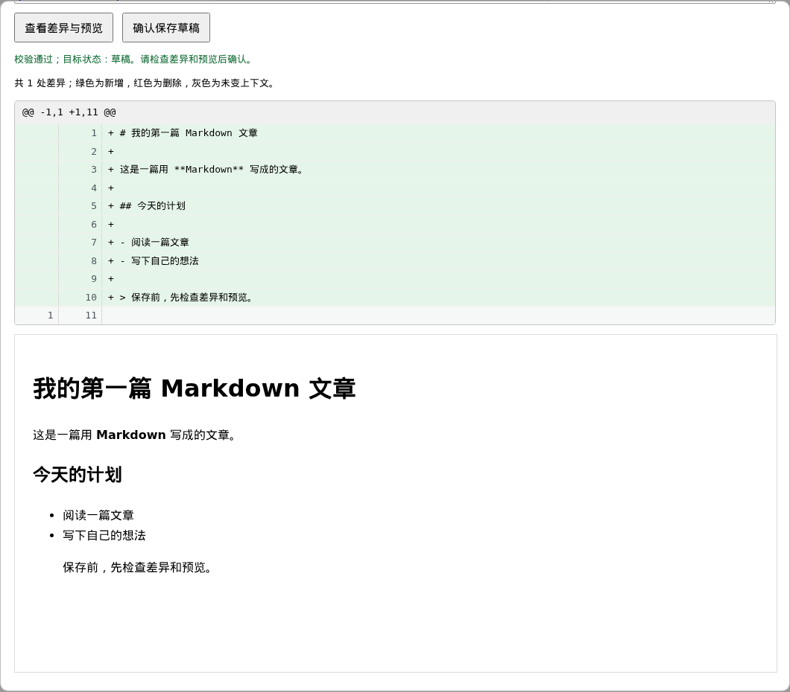
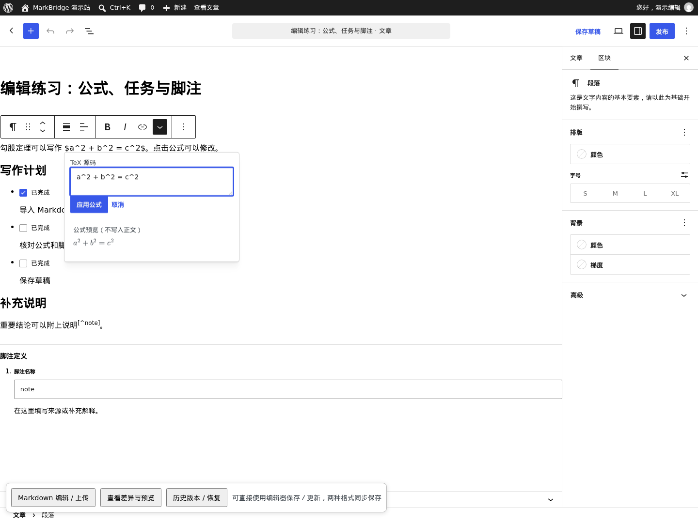
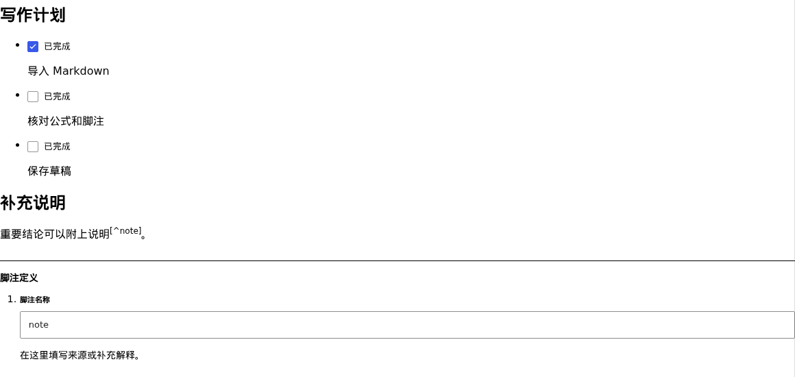

# 编辑与发布

本文适用于 MarkBridge **2.6.0-rc.2**。先学习已有文章的日常保存，再按需要使用公式、任务列表和脚注；最后介绍冲突处理与历史恢复。第一次创建文章请先看带截图的[快速开始](GETTING-STARTED.md)，遇到错误请查[常见问题](TROUBLESHOOTING.md)，版本变化见[更新记录](../CHANGELOG.md)。

## 编辑长文与复杂内容

源码搜索、字节保留替换、定位与并排预览见[长文编辑](SOURCE-NAVIGATION.md)。受信教学组件提供参数表单与高级 JSON，修改后明确应用或放弃；节点图的可视化编辑由独立扩展提供。所有修改仍走相同的差异预览、配对保存与修订流程。

## 选择本次编辑方式

| 你想做什么                     | 从哪里开始                    | 如何保存                               |
| ------------------------------ | ----------------------------- | -------------------------------------- |
| 调整已有文章的段落、列表或标题 | 文章的 WordPress 区块编辑器   | 原生保存／更新／发布按钮               |
| 编辑原文或重新上传 `.md`       | 底部 **Markdown 编辑 / 上传** | 查看差异与预览，再确认目标状态         |
| 修改绑定服务器源文件的文章     | 底部 **Markdown 原文 / 预览** | 配置受信目标后，预览并明确确认写回     |
| 找回已保存的旧稿               | **更多 → 历史版本 / 恢复**    | 查看恢复差异与预览，再确认恢复两种格式 |

电脑上传的 Markdown 不会自动绑定为服务器源文件；保存文章也不会改写电脑上的原文件。

## 日常编辑与保存

### 在可视化编辑器保存

1. 在 **文章 → 所有文章** 打开已有的 MarkBridge 文章。
2. 修改标题、段落、列表等区块，按需调整文章设置。
3. 点击 WordPress 的 **保存草稿／更新／发布**，等待成功提示。
4. 需要核对原文时，打开底部 **Markdown 编辑 / 上传**；需要核对页面时，使用 WordPress 预览或 **查看文章**。



普通 Markdown 托管文章使用原生按钮保存时，服务器把区块转换回 Markdown，验证可安全往返后，将两份正文和本次原生字段修改一起保存。底部 **查看差异** 是可选检查入口；导出、历史恢复和转换检查位于 **更多**。后台自动保存仍关闭，请主动保存。

托管编辑器 **更多** 中的 **转换支持与当前内容** 面板会列出常见支持区块，并提示当前文章中尚不支持转换的区块。可展开面板并点 **检查当前区块转换**，在浏览器中检查当前内容能否往返为 Markdown。检查只读取当前区块，不改写输入；区块类型受支持不代表其所有样式和属性都能保留。最终保存时服务器仍会重新转换和校验，浏览器检查通过不保证服务器一定接受。

遇到无法转换的区块或样式、权限或发布条件不满足、版本冲突时，会显示错误并保留当前编辑内容。转换错误会在能够可靠定位时标出 Markdown 行、区块路径或属性，并给出检查方向；不能确认的位置会省略，不会用猜测的行号代替。先复制重要修改或下载 Markdown 候选，再按提示检查格式和属性，修正后重新预览或保存；版本冲突则核对服务器最新版。不要直接刷新丢弃草稿。普通非托管文章的原生流程不受影响。

### 改 Markdown 或上传新版文件

从编辑器底部 **Markdown 编辑 / 上传** 打开窗口；也可以进入 **工具 → Markdown 编辑桥**，选择文章旁的 **Markdown 编辑**。

1. 在 **Markdown 原文** 中修改文字，或选择新版 `.md` 文件。
2. 检查 **标题**、**稳定文档 ID** 和 **保存为**。已有文档的 ID 保持不变。
3. 点击 **查看差异与预览**，校验后会显示正文预览；通过窗口顶部 **源稿与差异** 和 **正文预览** 切换，核对新增、删除和排版结果。
4. 确认后点击对应的 **确认保存草稿／确认提交审核／确认公开发布／确认私密发布**。



图中为首次导入示例，当前界面的按钮位置可能不同；已有文章会比较当前已保存内容与本次候选。窗口底部持续提供状态与确认按钮，未通过预览不能保存。没有元数据提案时，相关高级区域默认折叠。上传、预览均不会保存；预览后再改标题、正文或状态，需要重新预览。重新上传会替换窗口中的候选正文，保存前请检查差异；不要通过 **上传新文档** 重建同一篇文章。

### 添加标题、链接、图片和代码

在可视化编辑器里，点击 **＋** 选择标题、列表、图片或代码区块；选中文字可使用工具栏加粗或添加链接。添加图片时先上传到 WordPress 媒体库，再选择插入。

如果更习惯 Markdown，可以在原文框中这样写：

```markdown
## 小节标题

这是一段 **加粗文字**，以及 [参考链接](https://example.com)。

- 第一项
- 第二项


```

图片地址必须可访问。单独上传 `.md` 不会一起上传电脑中的图片；带本地图的文稿须使用下文的资源 ZIP 入口，不能仅靠 `./images/photo.png` 自动找到电脑文件。代码可使用 Markdown 围栏（以三个反引号开头和结尾），并在开头注明 `python` 等语言名称；粘贴到代码区块里的 `$`、脚注和任务标记都会作为代码保留。

保存前可使用预览检查排版。遇到复杂第三方区块或不能往返的样式，插件会明确拒绝保存，原编辑内容保留；处理办法见[常见问题](TROUBLESHOOTING.md)。

### 草稿、审核与发布

首次导入建议先保存草稿，再在文章设置中选择 **特色图片**。有发布权限时可公开或私密发布；没有发布权限时可保存草稿或提交审核。新文章公开／私密发布需要媒体库中的有效特色图片，正文图片不能代替封面。完整步骤见[快速开始](GETTING-STARTED.md#6-添加封面然后发布)。

更换封面后，在文章编辑器保存；编辑器内打开的 Markdown 窗口也会读取当前选择的特色图片。在工具页打开窗口不提供封面选择器。

### 编辑服务器文件来源文章

显示 **正文由源文件同步** 的文章由管理员绑定服务器源文件。配置了受信写回目标并通过权限与双端版本校验后，才能编辑、预览并明确确认写回；普通原生保存不能替代确认。

未配置写回目标时只读。绑定文件无法读取时显示 WordPress 已保存副本并保持只读，该副本可能不是源文件最新版；请联系管理员。CLI 同步、绑定路径和回退细节见[服务器配置](RUNTIME.md#升级与历史迁移)。

### 使用原生详情、按钮和静态扩展

MarkBridge 支持 WordPress 原生详情区块，以及按钮组内的链接按钮；它们继续保留原生区块身份。详情标题使用单行纯文字，内部可放已有支持的段落、列表、公式、代码和图片。按钮文字支持有限文字格式，自定义样式、互斥详情分组和动作按钮超出往返范围时会拒绝保存。

安装兼容的受信静态扩展后，也可以插入其登记区块。参数 JSON 是候选输入，须明确应用或撤销；无效或未应用输入会阻止保存。缺包或版本不符保留已有配置与内容，提示先恢复兼容扩展，不能自动删除区块。Markdown 表达和具体限制见[原生区块与静态适配接口](BLOCK-ADAPTERS.md)。实际验收范围见[验证说明](VALIDATION.md)。

## 公式

### 编辑已有行内公式

区块编辑器默认显示行内公式的排版结果。

1. 点击公式，或聚焦后按 Enter / 空格，打开 TeX 输入框与小型预览。
2. 修改源码，选择 **应用公式**；取消或 Esc 保留原值。
3. 使用文章保存按钮保存。文件来源文章仍需预览并确认写回。



保存成功后，排版公式与 Markdown 中的 TeX 一起保存。

<details>
<summary>注意事项与兼容边界</summary>

应用公式只修改编辑内容，还没有保存文章。排版失败时保留源码；浮层打开期间公式发生变化时，需要重新选择，避免覆盖新内容。预览节点不会写入正文。

</details>

### 新建行内公式

在 MarkBridge 托管文章中：

1. 在正文富文本工具栏的 **更多** 中选择 **数学（MathJax）**；也可以先选中一段纯文本，以它作为 TeX 初值。
2. 输入不带外层美元符的单行 TeX，例如 `a^2 + b^2 = c^2`。
3. 等待预览成功，选择 **应用公式**，再保存文章。取消不会修改正文。

也可以在正文中逐字键入 `$a = b$`，闭合美元符后自动变成行内公式；一次撤销可恢复完整字面文字。有歧义或较长的公式请使用工具栏。

<details>
<summary>注意事项与兼容边界</summary>

含其他格式或对象的选区不能直接替换，以免丢失格式。自动识别只处理本次短文本输入，不扫描旧内容，不处理粘贴、输入法组合过程、代码或带其他格式的范围。

金额、转义美元符和未闭合表达式保持文字；相邻公式请用空格或文字分隔，或合并为一个 TeX 公式。紧接已有公式的第二段 `$…$` 保持字面文字，避免中间 `$$` 与行间分隔符歧义。普通文字中的美元符仍会在 Markdown 中转义，不能通过取消转义来强制识别。

</details>

### 新建行间公式

在空段落仅键入 `$$` 后按 Enter，可创建 **行间公式** 区块并进入 TeX 输入框；也可从区块插入器选择 **行间公式**。

选中时编辑源码，离开后显示排版结果。应用或插入公式仍需保存文章；文件来源文章仍需差异预览和明确确认。

### 转换 WordPress 原生数学

核心的 **数学** 与插件的 **数学（MathJax）** 使用两种存储格式。插件保留核心格式注册和已有内容，不会自动迁移文章；托管文章的新建行间入口使用插件的 **行间公式**，普通非托管文章保持原生入口。

| 当前选中内容 | 直接转换入口                           |
| ------------ | -------------------------------------- |
| 原生行内数学 | 公式旁 **转换为行内公式（MathJax）**   |
| 原生数学区块 | 区块上方 **转换为行间公式（MathJax）** |

点击入口发起核对，原工具栏入口也保留。转换成功后才进入既有双格式保存链，请继续保存文章。保存后使用插件的公式格式显示，原文仍保留 TeX。

<details>
<summary>注意事项与兼容边界</summary>

只有可恢复的 TeX、可核对的 MathML 且没有会丢失的额外属性时才允许转换。缺少源码、样式不能保留、排版失败或验证期间内容变化都会拒绝，保留原对象；不会放宽对任意 MathML 或 HTML 的保存限制。

</details>

## 任务列表

### 添加与修改任务

1. 在区块插入器选择 **任务列表**。
2. 输入任务内容，在后台勾选或取消勾选完成状态。
3. 使用文章保存按钮保存；Markdown 编辑或文件写回仍需差异预览与确认。

也可以在 Markdown 中使用 `- [ ]` 和 `- [x]`（接受 `[X]`）：

```markdown
- [ ] 核对文章内容
- [x] 完成草稿
```



保存后，Markdown 与区块会保留任务状态。读者能在前台看到完成状态，复选框只读；更改任务请回后台编辑。

<details>
<summary>注意事项与兼容边界</summary>

支持普通项混排、有序列表、嵌套、后续段落、引用、代码与公式。转义标记和代码内容不作为任务，不自动迁移既有文章。

删除最后一个任务后，如果剩余内容可表示为普通列表，选中列表容器，在区块工具栏中选择 **转换为普通列表** 再导出。复杂的多段落普通列表继续保留原区块。两个独立的同类列表之间需要正文段落分隔；紧邻列表在 Markdown 中会合并，无法保留原区块结构时会拒绝导出。

历史复杂列表中作为普通段落保存的 `[x]` 仍可精确恢复旧配对，但前台显示字面标记；显式重新导入原 Markdown 后才使用新的任务状态区块。

</details>

## 脚注

### 在 Markdown 中写脚注

使用命名引用与定义；脚注名称支持 1–64 个字母（含中文）、数字、下划线或连字符，区分大小写：

```markdown
正文中的说明[^note]，再次引用[^note]。

[^note]: 第一段说明。

    第二段说明，也可以包含已有支持的列表、代码或公式。
```

### 在区块编辑器中编辑

1. 在正文富文本工具栏的 **更多** 中选择 **插入或修改脚注引用**，填写名称。
2. 在文末插入 **脚注定义** 区块，填写同名名称并编辑说明内容。
3. 使用文章保存按钮保存；也可以在 Markdown 编辑桥中编辑，检查差异与预览后确认保存。

### 保存后的阅读效果

前台按首次引用顺序编号，重复引用分别提供返回链接；同页多篇文章互不串跳。保存时保留定义顺序，不把阅读编号写回 Markdown。删除引用时同时删除不再使用的定义。

<details>
<summary>注意事项与兼容边界</summary>

引用改名后须修改对应定义及其他引用，否则配对校验会拒绝保存。缺失、重复、未使用的定义、脚注定义中的脚注引用、链接或图片文字中的引用会明确拒绝。匿名 `^[说明]`、原生 WordPress 脚注区块或第三方脚注格式不自动转换。代码与转义文字保持字面；历史普通文字中的未定义标记仅允许精确恢复旧配对，不自动迁移。

</details>

## 教学内容

MarkBridge 提供折叠内容、单篇阶段阅读与正文代码对照。先写完整题意和解释，再用这些结构安排提示与分步阅读；Markdown 与可视化编辑器仍保存同一份内容，读者临时状态不写回文章。操作、语法和兼容边界见[教学内容](TEACHING.md)；已安装其他版本时，以对应版本文档为准。

## 冲突与旧文件

如果服务器文章或源文件在编辑期间发生变化，保存会被阻止，编辑桥显示 **版本冲突：核对服务器与当前候选**。

1. 先点击 **下载当前候选 .md** 保留修改；候选不能转换时复制重要文字并保留编辑页。
2. 点击 **重新读取服务器最新版**，比较标题、状态与正文差异。
3. 可选择 **准备三方合并**，对照打开时版本、我的候选与服务器最新版。独立修改可组合；重叠正文、标题、状态或封面须逐项选择，再采用未保存的合并候选。
4. 再次 **查看差异与预览**，确认后保存。

三方合并需要本次打开时的可信基线。旧恢复记录、基线过期、来源文件与已保存配对不同，或比较超过容量时，保留手动比较与候选下载。手动选择 **保留我的修改，基于最新版继续** 只更新核对基准；也须明确处理元数据差异，不会保存正文。采用期间服务器再次变化会拒绝，原候选保留。

未修改的标题、状态和封面继承服务器最新版；Front Matter 的明确选择仅在头部未变时保留，头部改变会提示重新选择。所有采用结果都须重新预览，不能绕过权限、来源和版本保护。等待旧请求期间继续输入后，旧失败不会锁住或替换新候选；成功保存的旧候选则明确报告已保存，并保留后续未保存输入。原生保存遇到冲突时，也先保留当前修改，再核对服务器最新版；不要直接刷新。

上传提示“已知旧版本”时，文件曾是该文档的历史内容，不能直接覆盖服务器更新。需要取回其中部分内容时合并原文；要恢复整份旧稿，使用下一节的配对恢复。其他错误见[常见问题](TROUBLESHOOTING.md)。

## 浏览器草稿恢复

**浏览器草稿恢复** 用于保留未保存修改。它默认关闭；已有文章从编辑器的 **更多 → 浏览器草稿恢复** 打开，新建文章可展开同名面板。阅读提示并勾选 **启用此浏览器的本地恢复** 后，才会备份未保存的 Markdown 或区块候选。这些文字未加密，保存在当前浏览器的站点数据中；共享设备不宜启用。它不能代替 WordPress 保存或来源文件备份。

窄屏侧栏遮住工具栏时，恢复入口会单独保留。有候选或授权异常时也会显示提示；不会因为收起辅助工具而隐去待处理状态。

刷新或重新打开同一文章后，选择 **恢复候选并查看差异**。恢复不会立即写入文章：Markdown 进入原有差异与预览；已有托管文章的区块可在核对后恢复到当前编辑器，再正常保存；新文章的区块候选须能精确转换，确认后才新建配对草稿。不可表示的修改会拒绝，原候选仍可下载。来源文件文章继续使用既有来源权限、双指纹和写回确认。

本地记录区分账号、文章、来源绑定及标签页。其他标签页的记录分别列出，不互相覆盖；旧基线候选标明须比较冲突，不自动改成服务器最新版。文章在回收站时先正常还原，已删除的文章不能按旧 ID 重建。正文、标题、稳定文档 ID、目标状态与封面 ID 在候选范围内；它不是整站或全部文章元数据备份。

最多保留 8 条、合计 1 MiB，每条完整 JSON 不超过 256 KiB，7 天到期。容量不足、网络校验失败或服务器版本变化时不会冒称备份成功，可用 **下载当前未保存候选** 先保留。登录校验过期时暂停恢复，刷新或重新登录后重新校验；实际权限撤销会拒绝目标文章的恢复。缺少可靠多标签存储锁的浏览器停用此功能，正常编辑仍可使用。

成功保存后只清理已保存的本标签候选，保存期间继续输入的内容仍须保留。普通新文章采用 WordPress 原生保存后仍是普通文章；如要把剩余本地候选导入 MarkBridge，确认会创建新的托管草稿。点击 **清除此账号的本地候选** 会清除并停用这个账号的本地记录；隐私模式、浏览器清理和到期均可能移除它们。实际支持范围和验收边界见[验证说明](VALIDATION.md)。

## Markdown 头部元数据

MarkBridge 允许在文件最开头写一个明确版本化的 Front Matter。它是元数据提案，上传或预览不会自动应用，更不会自动发布文章。这不是通用 YAML：字段值使用单行 JSON，例如：

```text
---
markbridge: 1
title: "一篇示例文章"
excerpt: "简短摘要。\n第二行。"
slug: "example-article"
status: "draft"
categories: ["tutorials"]
tags: ["algorithms"]
featured_media: 0
---

## 正文从这里开始
```

打开 **Markdown 编辑 / 上传** 后，元数据面板分别显示文章当前值和文件提案。默认不勾选任何字段；勾选希望应用的项目，点击 **查看差异与预览**，核对实际解析结果，再确认保存。更改选择或内容后须重新预览。标题、摘要、固定链接名称、状态、已有分类／标签的 slug 和特色图片 ID 是全部支持字段；未写的字段不改变，不接受作者、日期或任意自定义字段。

分类与标签必须已存在，插件不会自动创建。特色图片 ID 属于当前媒体库，不可直接搬到另一站点使用。状态仍受本次账号的发布权限和封面规则约束；固定链接名称发生冲突会拒绝，不自动添加数字后缀。头部不显示在前台正文中，原始换行与内容保留在配对 Markdown 中。

正常修改 WordPress 文章设置不会偷偷重写头部。需要更新文件提案时，选择面板中的 **将当前元数据写入头部**，检查候选再预览与保存；这个按钮只修改窗口里的候选，不写入服务器。历史恢复只恢复原有双格式正文和既有修订字段，不自动应用历史头部中的分类、状态或封面提案。

头部最多 16 KiB，标题最多 200 个 Unicode 字符，摘要最多 8 KiB，分类／标签每项最多 100 个已有 slug。没有 `markbridge: 1` 的旧式 YAML 仍按原有正文处理；不会因为升级而自动转换历史文章。

## 导入带本地图片的文稿

把一个 Markdown 文稿与它引用的图片一起打成 ZIP，例如：

```text
lesson.zip
├── article.md
└── images/
    ├── diagram.png
    └── photo.jpg
```

文稿使用 ``。相对地址从文稿所在目录计算，可以使用不越过 ZIP 根目录的 `.`／`..`；图片条目本身须使用正常目录名称。已有网络图片 URL 保留，服务器不会下载它们。普通链接和代码中的路径不会作为图片导入。

1. 在新建文章入口或已有数据库托管文章的 **Markdown 编辑 / 上传** 中选择 ZIP。
2. 核对读入的文稿、图片名称、类型和尺寸。这时只有服务端私有暂存，不创建媒体附件、不保存文章。
3. 阅读并明确勾选媒体提示：WordPress 的静态媒体 URL 可能公开，即使文章是草稿或私密文章。
4. 点击 **查看差异与预览**。面板显示图片目标替换及规范化后的 Markdown；临时 `mbb-import/...` 是预览标识，确认保存时才换成 WordPress 最终媒体 URL。代码和普通链接的目标不替换，版本头原样保留。
5. 核对后确认保存。图片与双格式正文走同一保存链，大图可能按 WordPress 正常媒体规则生成缩放图和尺寸副本。保存后重新打开可查看最终地址。

资源 ZIP 最多 8 MiB、100 项；真实展开总量最多 32 MiB，只接受一个 UTF-8 Markdown 和最多 32 张 PNG／JPEG／GIF／WebP。单图最多 8 MiB、3200 万像素，不支持 SVG、加密包、链接条目或其它文件。不同相对图片地址最多 256 种；同一图片的路径别名与重复引用不会重复创建附件。每种配对正文仍受 256 KiB 限制，PHP 的上传设置可能进一步限制 ZIP 大小。

须有本次文章的编辑／创建权限和媒体上传权限；运行环境还需 PHP zip、intl、POSIX 与可写的 Web 根外私有暂存，浏览器需 HTTPS 或受信本地环境提供的 Web Crypto。缺少条件时明确拒绝资源导入，普通 Markdown 编辑仍可使用。文件来源文章不从 ZIP 推断服务器资源映射，继续由原来源维护图片。

隔离预览维持禁脚本的空 sandbox，仅嵌入重新鉴权、校验后的图片；总预览最多 8 MiB／1600 万像素，重复图片也计入。超预算图片显示明确占位，实际导入限制仍须通过；读取、权限、类型或摘要失败会阻止确认，保留候选供重试。

点击 **取消图片导入，保留文稿** 后文稿仍在；若继续引用待上传图片，须重新上传 ZIP 或移除这些引用。临时批次 15 分钟到期，每个账号最多保留四批；本地恢复只保存有界的待上传路径提示，不保存 ZIP 字节或导入凭据。保存失败只清理本次新增资源；提交结果不确定时保留媒体与恢复记录，先核对文章或联系管理员，勿盲目重复保存，不删除既有附件。

## 导出已保存文章

在已有托管文章的底部工具栏或编辑桥列表选择 **导出已保存文章**。先选择格式，再点击 **准备导出与资源清单**；核对内容、资源与保留的外部图片后，点击 **确认下载**。此入口导出服务器上已经保存的版本，编辑器中尚未保存的修改不会包含在内。下载前文章或图片发生变化时须重新准备。

- **Markdown**：保留原始文本字节、换行和已有 Front Matter，不另填入当前文章设置。无需 ZIP 扩展或服务器文件来源权限。
- **ZIP**：包含 `document.md`、可验证的关联图片和版本化的 `markbridge-export.json` 清单。正文中实际使用、直属于本篇文章的本地图片会替换为包内地址；代码与普通链接保持原样。清单包含标题、摘要、slug 与分类／标签 slug，作为可携带的信息，不会在重新导入时自动更改文章设置。
- **静态 HTML**：生成可离线阅读的单文件，嵌入已核验的本篇本地图片、公式字体与数学语义。外部或无法核验的图片会在准备时拒绝，不联网抓取。所有阶段、折叠、证明和代码语言版本完整保留，交互演示仅含作者静态 fallback。公式处理失败、取消或超过预算时不下载不完整文件。详见[静态导出合同](STATIC-EXPORT.md)。

Markdown／ZIP 中未关联的图片、其他文章的附件或外部图片保留原 URL，并在清单中提示；静态 HTML 则在准备时拒绝这些图片。服务器不抓取外部 URL，也不搜索媒体目录。图片引用使用共享定义时，ZIP 中相应的图片引用会展开为行内图片，普通链接和原定义保留。原始文章和源文件不会因此修改。文件来源文章导出 WordPress 已保存的配对副本，不读取或打包服务器源文件、绑定路径和私有映射。

ZIP 使用与资源导入相同的图片类型及容量边界：最多 32 张受支持位图、单图 8 MiB／3200 万像素、展开总量 32 MiB、最终 ZIP 8 MiB，每种正文 256 KiB。带本地附件 ID 的便携 ZIP 明确拒绝；原始 Markdown 可保留站点关联，不能将其中 ID 当跨站身份。静态 HTML 可验证后嵌入图片，最终文件不含可写媒体身份。另需 PHP zip、intl、POSIX 和 Web 根外的安全暂存。超过限制会拒绝整包，不悄悄省略图片。可将 ZIP 从资源导入入口重新上传，重新预览和明确确认；仍须遵循媒体公开提示、权限及正常配对保存规则。

静态 HTML 沿用最多 32 图、单图 8 MiB 的限制；描述及最终 HTML 分别最多 32 MiB，重复 data URI 也计入最终体积。生成时只读取已保存配对副本，不改动正在阅读的页面。

每个账号最多保留四个导出候选，15 分钟到期。取消或成功下载会领取并清理本次候选；权限变化、凭据失效或版本冲突均须重新准备。导出不带评论、私人笔记、修订、作者身份、凭据或源文件绑定，也不是完整站点备份。

## 选择界面语言

在 WordPress **用户 → 个人资料 → 语言** 选择中文或英文，保存后重新打开编辑器。管理员在 **设置 → 常规 → 站点语言** 选择读者看到的界面语言。两处可以不同：作者用英文后台，读者仍可看到中文的代码页签、公式和教学控件。

切换只影响插件控件和提示，不翻译文章、代码、公式或作者标题，也不重新保存正文。受信扩展需要自身提供对应翻译；旧扩展或缺少译文时保留其原显示或英文回退。文档中的中文按钮名称对应中文界面。

## 历史恢复与删除

### 同时恢复 Markdown 与区块

1. 先保存当前修改，或另行复制保留。编辑器有未保存修改时不能恢复。
2. 点击编辑器的 **更多 → 历史版本 / 恢复**，或编辑桥列表中的同名按钮。
3. 选择历史版本，点击 **查看恢复差异与预览**；此时尚未恢复。
4. 检查后点击 **确认恢复两种格式**。

文件来源文章不能从此入口直接恢复，请通过既有源文件同步流程处理。

恢复所选版本的标题、Markdown 与区块；当前已保存版本保留在历史记录中。文章 ID、作者和可见性保持不变。历史配对不兼容、损坏或不能验证时会拒绝恢复，保留当前文章；不要只还原其中一种正文。

### 移至回收站或还原文章

在 **文章 → 所有文章** 中移至回收站；需要找回时进入 **回收站 → 还原**。移入回收站不会丢弃两种正文，编辑桥列表不显示回收站文章；永久删除请使用 WordPress 回收站操作。

服务器文件来源的外部文件不会随 WordPress 文章删除，源文件与同步映射由管理员另行维护。

## 管理员设置入口

管理员进入 **设置 → MarkBridge**，通过页签切换常规设置与图片表情包。安装兼容的独立 GitHub 更新器后，增加 GitHub 更新页签；未安装时不显示空入口。更新器仍默认关闭并要求单独网络同意与更新权限，多站点保留网络管理入口。旧设置链接继续可用，导航不会修改正文或配置。

## 服务端配对备份

已有托管文章的“草稿恢复”面板同时显示服务端备份和原有浏览器恢复。服务端备份在本页启用，停止输入 30 秒后尝试、最多每分钟一次；页面关闭后不继续运行。只备份已通过服务器双格式转换和配对校验的候选，失败时保留当前输入并提示，不把失败称为已备份。新草稿、未应用的配置和尚未通过转换的内容继续使用当前编辑器或可选择启用的本机恢复。

每账号／文章最多 10 份，7 天到期，全站容量 32 MiB、最多 4096 份。到期记录随备份请求惰性清理，没有新增定时任务。备份存于 WordPress 私有非自动加载选项；仅当前账号且仍有该文章编辑权限时能读取，不作为附件或公开下载地址。站点数据库备份仍可能包含这些数据。

点击“恢复候选并查看差异”只将候选放入差异预览，不保存正文、不创建正式修订、不写来源文件。旧文章基线会明确标示，以当前正文比较；没有原始已签名基线时不提供虚假的三方合并。再次输入、基线／权限／来源绑定变化或会话过期会中止迟到的恢复操作。文件来源指纹发生变化时拒绝恢复，须先按原来源工作流核对。正式保存和来源写回仍使用原有预览、权限、来源指纹及冲突检查。

列表分别显示最后配对备份和最后正式保存时间。备份不能替代正式保存；关闭服务端备份仅停止本页后续尝试，已有记录可逐份删除，到期后清理。浏览器恢复仍需单独选择启用，并受共享设备隐私与本机容量限制。

## 内容导航、检查、样板与粘贴

区块编辑器的“更多 → 内容导航与检查”和 Markdown 编辑器的“查找、替换与导航 → 内容导航与检查”共用入口。按公式、图、表、声明、文献和教学结构筛选，点击对象定位。来源以当前输入派生，不创建第二份可写正文。稳定标签重命名先检查引用影响，再明确应用；输入发生变化后须重查。在 Markdown 中应用重命名会重新序列化当前可往返表示，操作可撤销；如需保留原始排版，可先下载当前输入。

“检查当前内容”分别显示必须修复的配对／结构／引用问题与可忽略的阅读建议，例如空图片替代文字。失效引用定位到引用所在区块；未应用的配置继续保留并阻止正式保存。浏览器检查只作辅助，服务器保存时再次验证。

WordPress 原生样板入口的“技术写作”分类提供技术教程、论文笔记及“题目、提示、推导与实验”。Markdown 同一面板也可插入同源结构。插入后是普通可编辑区块，不依赖教学运行扩展；模板不携带可重复的稳定对象 ID。需要嵌套阶段或折叠时，继续使用已有“插入教学结构”入口，每次插入分配新 ID。

粘贴仅识别完整独立的多行 `$$` 公式、闭合代码围栏和明确多行列表。原生区块仅空段落可进入识别预览；已有文字或富 HTML 使用 WordPress 原有粘贴行为。Markdown 编辑器在当前选区预览插入。先核对预览再插入，取消保留原输入，接受后单次撤销可还原；原生入口也可选择保留纯文本。行内价格、转义美元、行内代码和不完整片段不触发此入口。代码中的美元与原文本保持原义，最终仍须正常转换、预览和明确保存。
